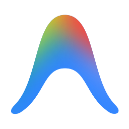

  

  

<h1 align="center">Google Antigravity Usage</h1>

Monitor subscription quotas and reset times in Home Assistant.

## Features

- **Gemini quotas:** Show five-hour and seven-day usage, remaining capacity and reset times.
- **Usage pace:** Compare weekly utilization with elapsed time.
- **Other models:** Report session and weekly usage for third-party models available under the plan.
- **Account identity:** Display the subscription tier and support multiple Google accounts.

## Install

Use the Marketplace badge above on Home Assistant 2026.11 or later to add this
repository as a custom integration. On older versions, add it as a HACS
custom repository of type **Integration**. Install and restart Home Assistant.
The badge does not imply a public catalog listing.

## Quick start

1. Create a **Google Antigravity Usage** application credential under
   **Settings → Devices & services → Application credentials** using an OAuth
   client ID and secret from your Google Cloud project.
2. Add **Google Antigravity Usage** under **Settings → Devices & services → Add
   integration** and sign in through Google's authorization flow.
3. If Google redirects to a localhost address, paste the complete redirected
   URL or authorization code into Home Assistant.
4. Inspect the usage, remaining-quota and reset-time sensors.

The flow uses PKCE and offline access to refresh tokens. Existing installations
can use the JSON content of `~/.gemini/antigravity-cli/antigravity-oauth-token`
as a legacy fallback. Home Assistant stores application credentials separately
from this repository.

## License

[GPL-3.0](LICENSE).
